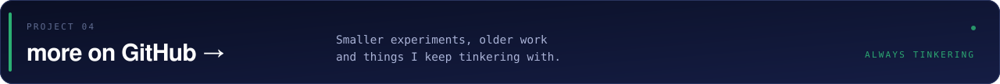

### Hey, I'm Selim

Senior frontend developer at [Shopier](https://www.shopier.com). I turn designs into fast, accessible, slightly-too-polished interfaces — since 2017, from Istanbul.

   

   

### What I care about

- **Simple over clever** — if it needs explaining, it can be simpler
- **Fast by default** — speed is part of the design
- **Details matter** — the small things are the product

### Right now

- Building at [Shopier](https://www.shopier.com)
- Making small things on the side
- Curious about what comes next

  <a href="https://selimyalinkilic.me">selimyalinkilic.me</a> ·
  <a href="https://www.linkedin.com/in/selimyalinkilic/">LinkedIn</a> ·
  <a href="mailto:yalinkilicselim@gmail.com">e-mail</a>

