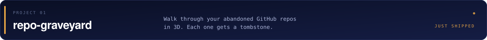
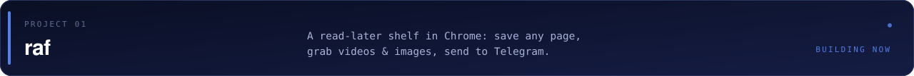
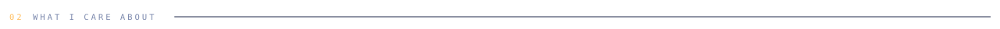
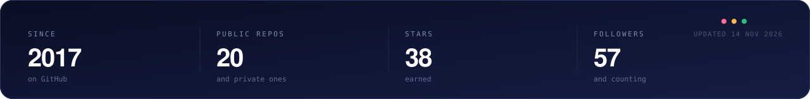
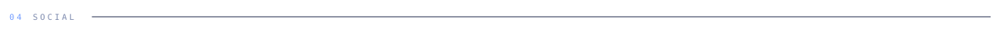
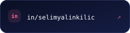

<picture>
  <source media="(max-width: 600px)" srcset="intro.mobil.svg" />
  
</picture>

<picture>
  <source media="(max-width: 600px)" srcset="sections/work.mobil.svg" />
  
</picture>

<a href="https://selimyalinkilic.github.io/repo-graveyard/"><picture>
  <source media="(max-width: 600px)" srcset="cards/repo-graveyard.mobil.svg" />
  
</picture></a>

<a href="https://github.com/selimyalinkilic/raf"><picture>
  <source media="(max-width: 600px)" srcset="cards/raf.mobil.svg" />
  
</picture></a>

<picture>
  <source media="(max-width: 600px)" srcset="sections/care.mobil.svg" />
  
</picture>

<picture>
  <source media="(max-width: 600px)" srcset="care.mobil.svg" />
  
</picture>

<picture>
  <source media="(max-width: 600px)" srcset="sections/github.mobil.svg" />
  
</picture>

<picture>
  <source media="(max-width: 600px)" srcset="stats.mobil.svg" />
  
</picture>

<picture>
  <source media="(max-width: 600px)" srcset="sections/social.mobil.svg" />
  
</picture>

    

