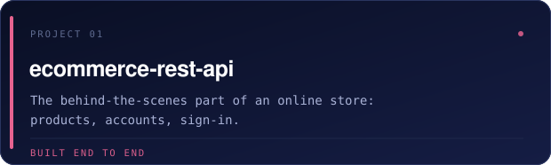
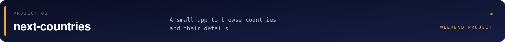
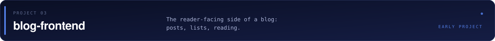

<picture>
  <source media="(max-width: 600px)" srcset="intro.mobil.svg" />
  
</picture>

<picture>
  <source media="(max-width: 600px)" srcset="sections/work.mobil.svg" />
  
</picture>

   

   

<picture>
  <source media="(max-width: 600px)" srcset="sections/care.mobil.svg" />
  
</picture>

<picture>
  <source media="(max-width: 600px)" srcset="care.mobil.svg" />
  
</picture>

<picture>
  <source media="(max-width: 600px)" srcset="sections/github.mobil.svg" />
  
</picture>

<picture>
  <source media="(max-width: 600px)" srcset="stats.mobil.svg" />
  
</picture>

<picture>
  <source media="(max-width: 600px)" srcset="sections/social.mobil.svg" />
  
</picture>

<a href="https://selimyalinkilic.me"><picture>
  <source media="(max-width: 600px)" srcset="social/site.mobil.svg" />
  
</picture></a>

<a href="https://www.linkedin.com/in/selimyalinkilic/"><picture>
  <source media="(max-width: 600px)" srcset="social/linkedin.mobil.svg" />
  
</picture></a>

<a href="mailto:yalinkilicselim@gmail.com"><picture>
  <source media="(max-width: 600px)" srcset="social/mail.mobil.svg" />
  
</picture></a>

